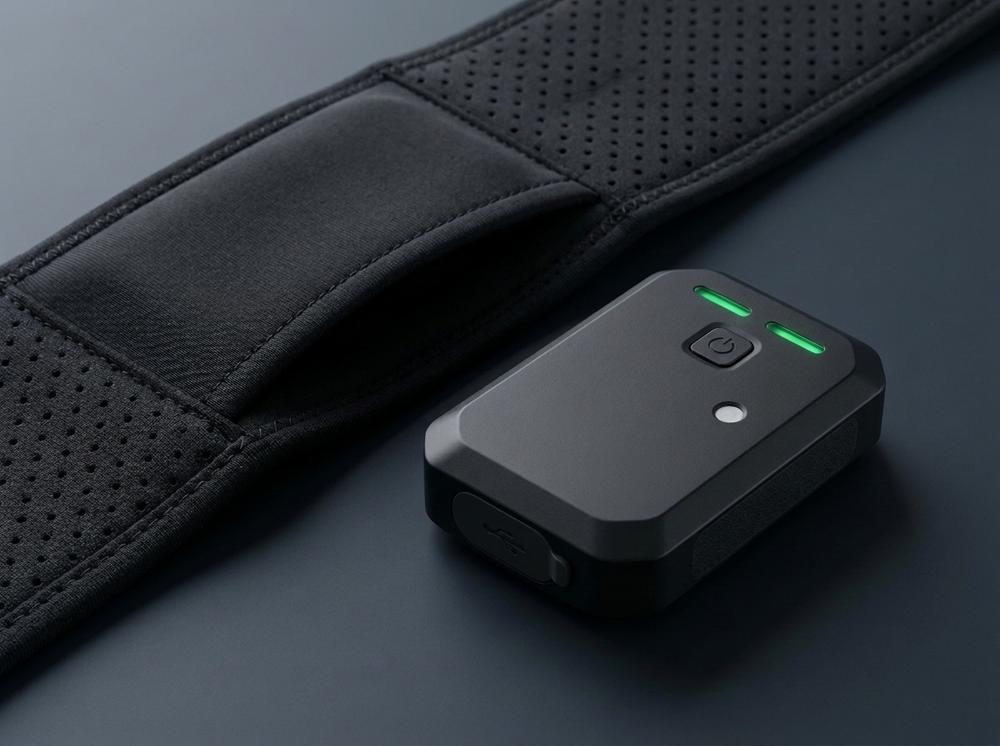
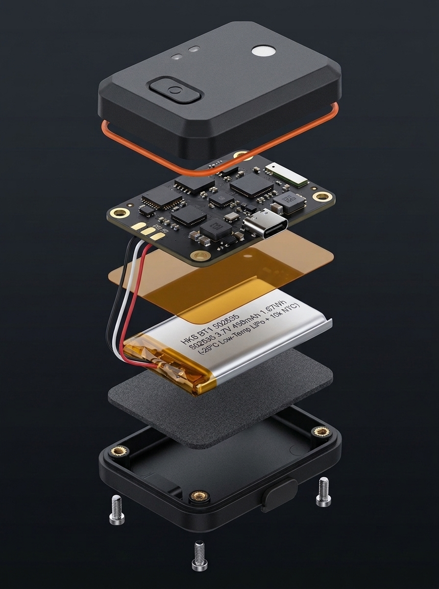
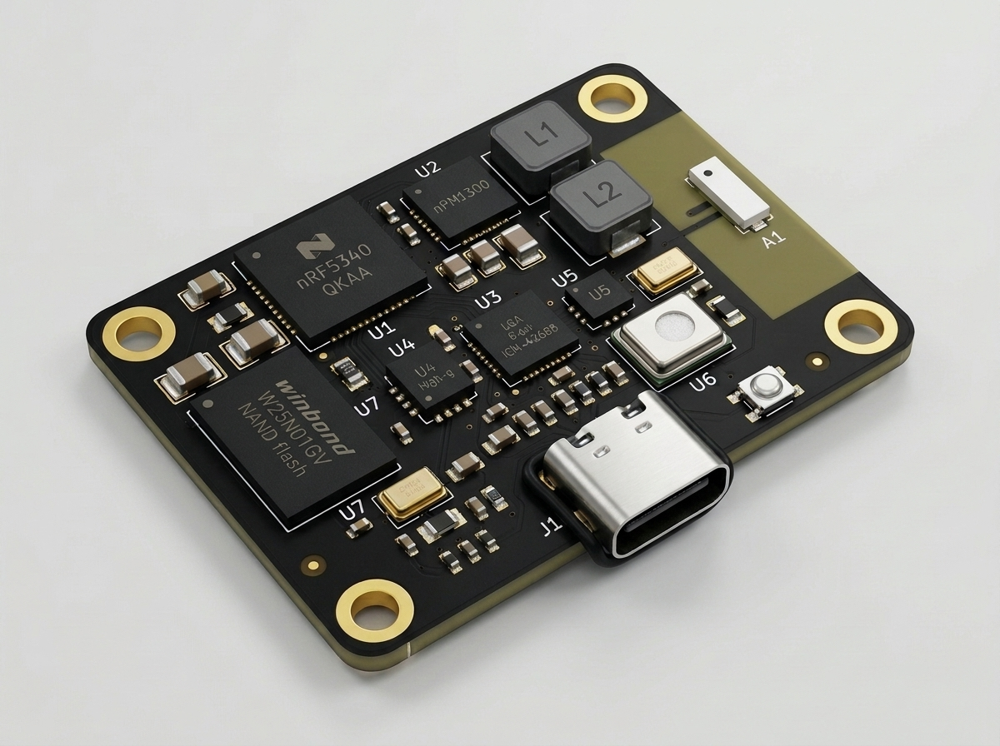
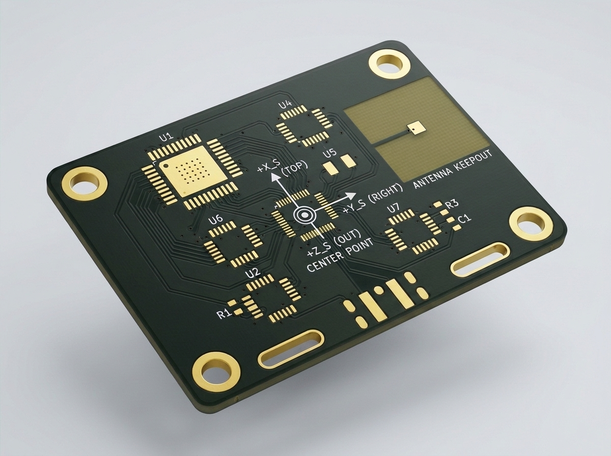
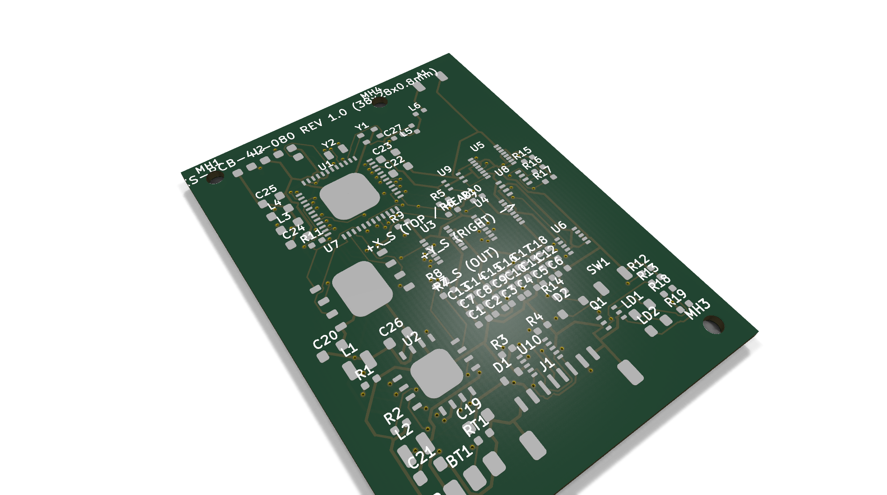
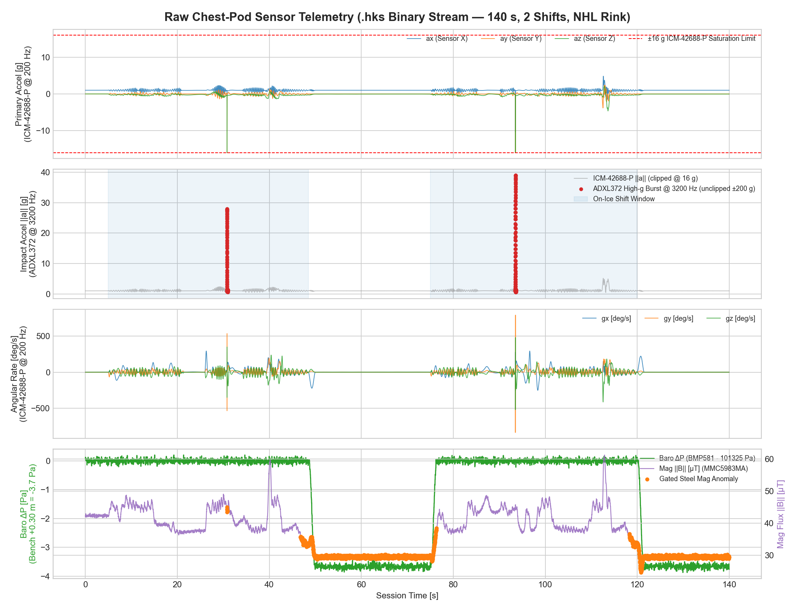
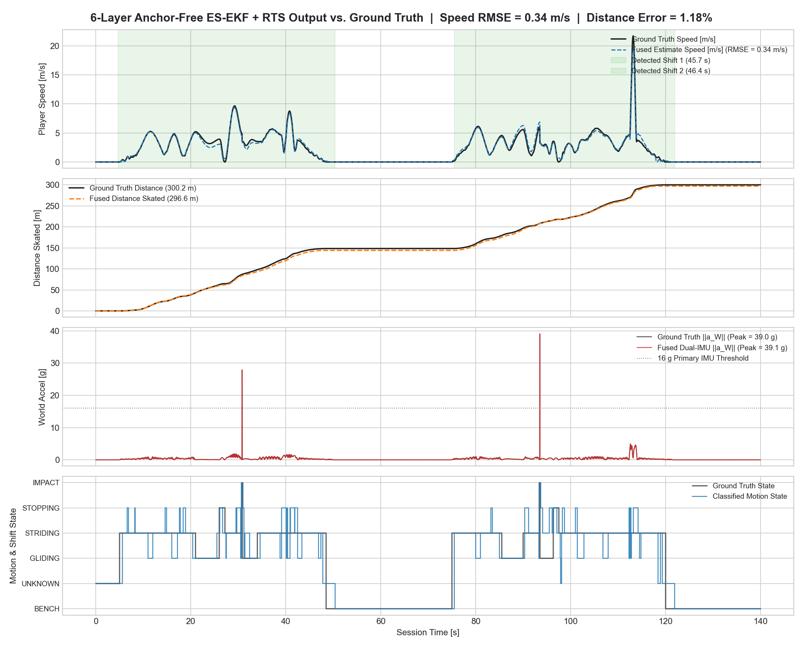
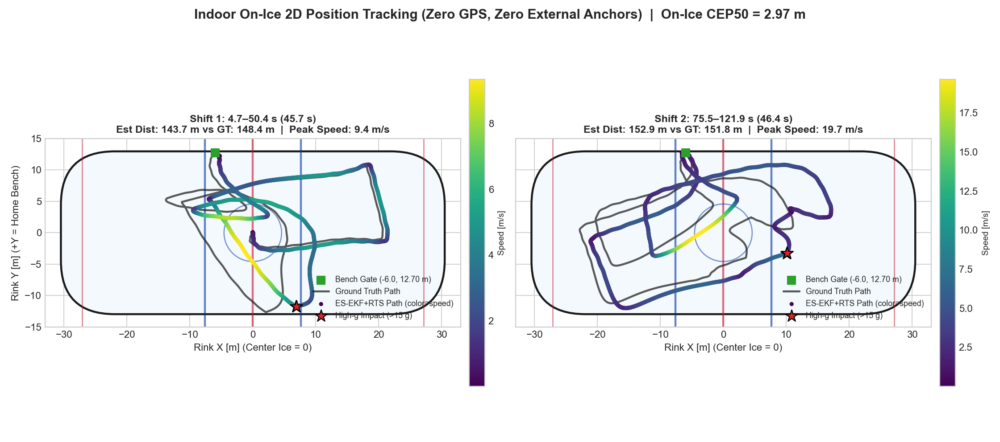

# Hockey Sensor (`HKS`) — Chest-Worn Indoor Ice Hockey Player Tracking System

Production-grade hardware, firmware, and host sensor-fusion suite for a discrete chest-worn indoor ice hockey player tracker (`52.0 × 36.0 × 10.5 mm`, `24.0 g`, IP67) operating **without GPS/GNSS or external rink-side anchors/beacons**.

## Tracked Metrics
- **2D On-Ice Position (`x_m`, `y_m`) & Trajectory Reconstruction** in Rink Frame $R$ (`60.96 × 25.91 m` NHL or `60.0 × 30.0 m` IIHF)
- **Skating Speed & Peak/Mean Speed** (`m/s`, `km/h`)
- **3-Axis Linear Acceleration & High-$g$ Impact Events** ($\pm 16\,g$ strapdown + $\pm 200\,g$ check/impact capture)
- **Shift Detection, On-Ice vs. Bench Gating & Shift Length** (`s`)
- **Total & Per-Shift Distance Skated** (`m`)

---

## Hardware & Industrial Design Renders

### 1. Chest-Worn Enclosure Concept (`52.0 × 36.0 × 10.5 mm`, `24.0 g`, IP67)


### 2. Exploded Assembly Stack-Up (`BT1` 502535 450 mAh LiPo Battery Underneath PCBA)


### 3. Populated 4-Layer PCBA Concept (`38.0 × 28.0 × 0.80 mm`)


### 4. Bare 4-Layer FR4 ENIG PCB Concept & KiCad 3D Raytraced Layout
| Bare 4-Layer PCB Concept | KiCad 3D Raytraced Routed PCB |
| :---: | :---: |
|  |  |

---

## Sample Session Telemetry & Sensor Fusion Output
| Raw Sensor Telemetry (`ICM-42688`, `ADXL372`, `MMC5983MA`, `BMP581`) | Fused Speed, Shifts, Distance & Acceleration |
| :---: | :---: |
|  |  |



---

## Repository Structure

| Path | Description |
| :--- | :--- |
| [`PROJECT_SPEC.md`](PROJECT_SPEC.md) | System requirements, coordinate frames ($R, B, S$), budgets, and validation gates |
| [`INTERFACE_CONTRACT.json`](INTERFACE_CONTRACT.json) | Single source of truth for `.hks` binary flash format, USB/BLE protocol, pinmux, and JSON output schema |
| [`docs/`](docs/) | System architecture (`architecture.md`), contract validator (`validate_contract.py`), and sample telemetry plots (`docs/plots/`) |
| [`hardware/ee/`](hardware/ee/) | Detailed schematic design (`schematic_design.md`), nRF5340 pinmux (`pinmux_and_buses.json`), and EE BOM (`bom.csv`) |
| [`hardware/mechanical/`](hardware/mechanical/) | IP67 PC/TPU + LSR overmolded chest pod specification (`enclosure_spec.md`), dimensions (`dimensions.json`), and mechanical BOM (`bom.csv`) |
| [`hardware/kicad/`](hardware/kicad/) | Routed 4-layer KiCad 8/10 project (`hockey_sensor.kicad_pro`, `hockey_sensor.kicad_sch`, `hockey_sensor.kicad_pcb`), Specctra DSN/SES (`board.dsn`, `board.ses`), DRC report (`drc_report.json`), and turnkey JLCPCB/PCBWay production files (`production/`) |
| [`hardware/power_budget.py`](hardware/power_budget.py) | $0\,^\circ\text{C}$ LiPo battery runtime, flash storage, and mass budget verifier |
| [`firmware/`](firmware/) | Freestanding C11 firmware suite (`libhks_fw.a`), 4096-byte NAND page logger, CRC-32C/SHA-256 integrity, USB CDC-ACM / BLE 5.3 transfer engine, and CLI simulator |
| [`sim/`](sim/) | 400 Hz skating physics truth generator (`physics_sim.py`), `.hks` binary codec (`flash_codec.py`), USB/BLE downloader (`downloader.py`), and 6-layer Error-State EKF + RTS backward smoother (`fusion_pipeline.py`) |
| [`e2e/`](e2e/) | 151-test end-to-end verification suite and 21-check 5-pillar production-readiness rubric (`run_e2e.py`) |

---

## Quick Start & Verification

```zsh
# 1. Validate interface contract & schema parity (27 checks)
python3 docs/validate_contract.py

# 2. Run hardware power, mass, storage, and pinmux unit tests (8 tests)
python3 -m unittest discover -s hardware/tests -v

# 3. Build and test freestanding C11 firmware (13 tests)
make -C firmware test

# 4. Run Python simulation & 6-layer ES-EKF + RTS fusion unit tests (8 tests)
python3 -m unittest discover -s sim/tests -v

# 5. Run full end-to-end test suite & 5-pillar rubric (151 tests, 21 rubric checks)
python3 e2e/run_e2e.py
```
